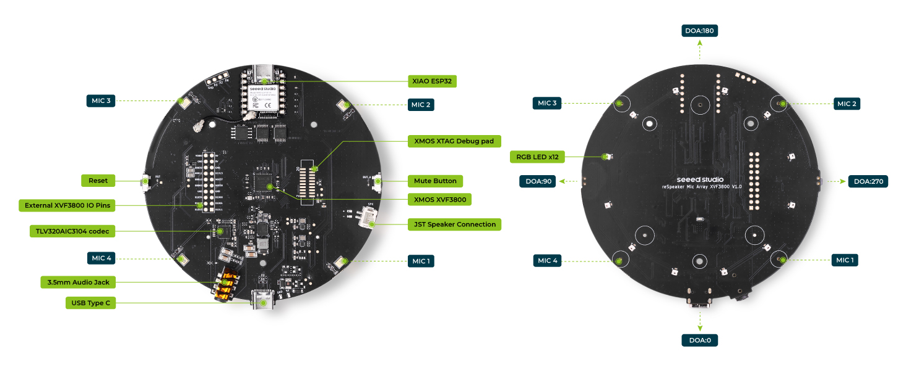
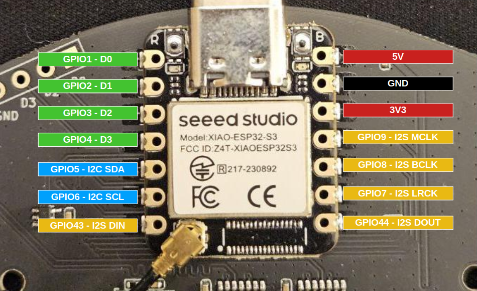
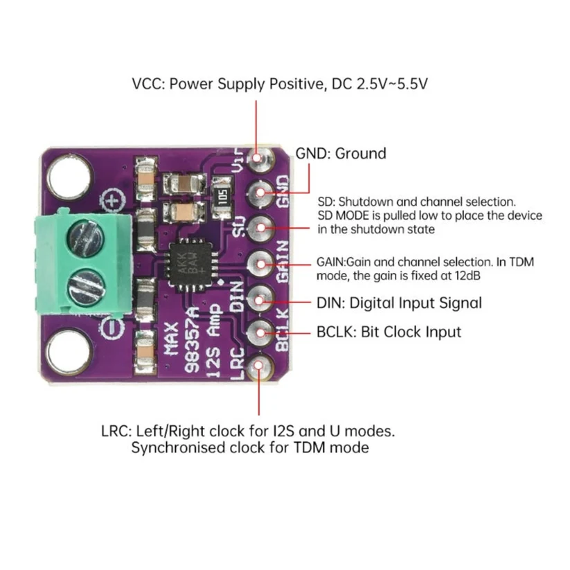
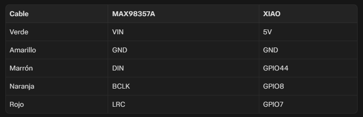

# XVF3800-USB-4-Mic-Array

Esta es una guía paso a paso para crear un altavoz de Home Assistant Voice con el siguiente material:

Seeed Studio XVF3800-USB-4-Mic-Array

Amplificador MAX98357A

Altavoz 3W

**<ins>[ACTUALIZACION DE FIRMWARE DE XVF3800]</ins>**

Descarga [el firmware del ReSpeaker XVF3800](reSpeaker-XVF3800-firmware/reSpeaker_XVF3800_USB_4MIC_ARRAY-master.zip).
Dentro del ZIP, el firmware se encuentra en:

xmos_firmwares
└── i2s

El directorio oficial separa las variantes I²S master de 48 kHz e I²S slave de 16 kHz. Hay que utilizar la I²S master de 48 kHz. Tiene un nombre del tipo "respeaker_xvf3800_i2s_master_v1.0.9_48k.bin".

Crea en el PC una carpeta temporal llamada C:\XVF3800

Copia en esa carpeta el fichero respeaker_xvf3800_i2s_master_v1.0.9_48k.bin y renómbralo a firmware.bin.

Descarga [el dfu-util](dfu-util/dfu-util-0.11-binaries.tar.xz) y descomprimelo dos veces con 7-zip.

En la carpeta descomprimida, localiza la subcarpeta "win64". Hay que copiar todo su contenido a C:\XVF3800

En la placa ReSpeaker XVF3800, hay que localizar el botón de MUTE.

Mantén pulsado Mute.

Sin soltarlo, conecta el ordenador al USB-C del XMOS: el de la placa circular, no el del ESP32-S3.

Espera a que el LED rojo empiece a parpadear.

Suelta el botón. La placa se habrá conectado en modo seguro.

Vuelve a la ventana del Símbolo del sistema y ejecuta:

dfu-util.exe -l

Deberían aparecer entradas similares a estas:

Found DFU: [2886:001a] ... alt=1, name="reSpeaker DFU Upgrade"

Found DFU: [2886:001a] ... alt=0, name="reSpeaker DFU Factory"

Si da un error del tipo "LIBUSB_ERROR_NOT_SUPPORTED" es necesario instalar un controlador WinUSB (si no es el caso, omite este paso)

Descarga [Zadig](Zadig/zadig-2.9.exe) y ejecútalo como administrador.

En el menú, selecciona:

Options → List All Devices

En el desplegable superior, busca un nombre como "reSpeaker 3800" o "reSpeaker XVF3800 4-Mic Array".

En el controlador de destino, selecciona WinUSB.

Pulsa Install Driver o Replace Driver, según muestre Zadig.

Espera a que termine y cierra Zadig. Desconecta el ReSpeaker.

Vuelve a hacer el paso explicado anteriormente para conectar la placa en modo seguro.

Con el XVF3800 conectado por USB en modo seguro y dfu-util ya funcionando correctamente, se escribe lo siguiente en la ventana de Símbolo de sistema:

dfu-util.exe -R -e -a 1 -D "C:\XVF3800\firmware.bin"

Espera a que termine la transferencia y vuelva a aparecer el indicador de comandos. En ese momento, desconecta el USB del puerto XMOS. El flasheo está completado.

**<ins>[CABLEADO]</ins>**

It is inspired by [this video from Domotica per Tutti](https://www.youtube.com/watch?v=EEh26tGFiz4)

**<ins>[REQUIRED MATERIALS]</ins>**

1.- ESP32-C6

2.- R503 Fingerprint reader

**<ins>[WIRING DIAGRAM]</ins>**

The ESP32-C6 must be flashed with [this YAML](fingerprint-thread.yaml) in ESPHome. The program is prepared for the ESP32 to connect to a Thread network.

**<ins>[HOW TO USE THE FINGERPRINT]</ins>**

In Home Assistant go to: Developer tools >>> Actions

To add fingerprints: esphome.tagreader_fingerprint_thread_enroll

To cancel adding fingerprints process: esphome.tagreader_fingerprint_thread_cancel_enroll

To delete a single fingerprint: esphome.tagreader_fingerprint_thread_delete

To delete all fingerprints: esphome.tagreader_fingerprint_thread_delete_all
